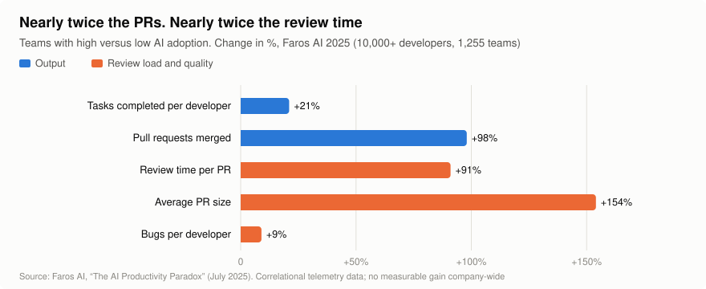
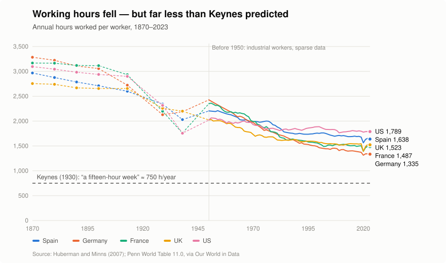
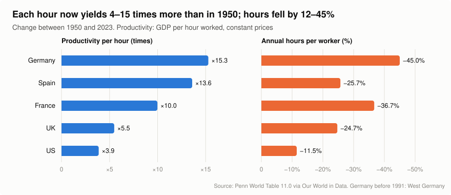
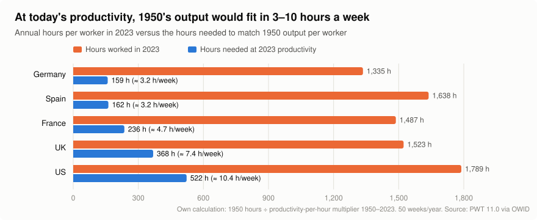
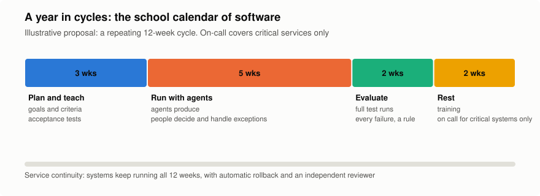

# Programmers Deserve Teachers' Holidays

*Why artificial intelligence forces us to decide who keeps the time it saves.*

**Raul Illana** · October 2026 · 18-minute read

---

> **In short**
>
> - With AI agents, programmers stop writing code and start teaching, assigning and marking. The job looks more like a teacher's than a machine operator's.
> - Agents produce more, but human work shifts to review: in teams that use AI heavily, almost twice as many pull requests (PRs) get merged, and each one takes almost twice as long to review.
> - We have been here before. Since 1950, each hour worked has come to produce between 4 and 15 times as much in five large economies, and yet we still work between 1,300 and 1,800 hours a year. Keynes imagined fifteen-hour weeks; we're stuck at nearly forty.
> - Sharing out the time saved is possible: in the four-day-week trials, most companies wanted to keep going. But it doesn't happen by itself. If nobody decides, AI will turn into more work, not more life.
> - The proposal: organise work with agents in cycles, like the school year, with protected periods of rest that are only possible if checking the work no longer depends on a person being awake.

---

## 0. A demand that started as a joke

It all began with a half-serious line: *if we have to raise a generation of artificial agents, we should get the summer holidays too*.

The joke works because there is some truth in it. Those of us who work with AI agents spend less and less time writing code and more and more time preparing context, setting tasks, marking results and teaching judgement. In other words, being teachers. And yet we still measure our work as if we typed every line ourselves.

This essay takes the joke seriously. It is not literally asking for three months' holiday for every programmer: the three months are a slogan. It asks for something harder to win: that someone decides where the time freed up by machines goes, instead of letting more work swallow it by default.

## 1. Programmers no longer program: they teach

An AI agent doesn't arrive knowing things. It may have extraordinary general knowledge and still fail the subject that matters: your system's architecture, your team's conventions, the security boundaries, the mistakes it must not repeat. Like a brilliant pupil who hasn't been coming to class.

The day-to-day work of someone who directs agents looks more and more like a teacher's:

| In the classroom | With AI agents |
|---|---|
| Preparing the syllabus | Providing context: architecture, documentation, conventions and limits |
| Setting exercises | Breaking a problem down into tasks that can be checked |
| Marking exams | Reviewing code, running tests, spotting the mistakes the agent can't see |
| Teaching judgement | Deciding when a solution that works is nonetheless insecure or impossible to maintain |
| Running the classroom | Dividing work among several agents so that their parts fit together |
| Updating the syllabus | Rewriting instructions and tools as fast as the technology changes |

The fundamental difference is that this pupil never sleeps. It can work through the night and hand in dozens of assignments at once. And that is where the problem starts.

## 2. The pupil who never sleeps

If pupils could study twenty-four hours a day and hand in a hundred assignments at once, nobody would conclude that their teachers should be available twenty-four hours a day to mark them. Being able to generate a thousand answers doesn't mean anyone can assess them properly in five minutes.

In software development, that is exactly what we are normalising. Recent data don't agree on how much time AI saves, but they agree on two things: we measure badly, and we review more.

### 2.1. How much time AI saves: less than we think

| Study | Sample | Result | Caveats |
|---|---|---|---|
| Cui, Demirer et al., *Management Science* (2025) | 3 field experiments, 4,867 developers (Microsoft, Accenture and another large company) | **+26%** tasks completed | 2022–2023 autocomplete assistants, not agents |
| Google, Paradis et al. (2024) | 96 engineers, one complex task | **−21%** time | A single lab task; wide confidence interval |
| METR (2025) | 16 experienced developers, 246 real tasks from their own projects | **+19% time**: they were slower. They expected to be 24% faster and, once finished, believed they had been 20% faster | Small sample; early-2025 tools |
| METR (2026), follow-up | 57 developers, more than 800 tasks | **−18%** time for developers from the original study and **−4%** for new ones, but no interval excludes zero | The authors themselves now consider it a poor measure: many refused to work without AI |
| Anthropic (2026) | 52 engineers, mostly junior, learning a library | No significant speed-up; **50%** comprehension score versus **67%** without AI | Learning task; funded by an AI company |

Two conclusions. First: the real effect ranges from slower to considerably faster, depending on the tool, the task and the person. The second is more uncomfortable: **we are very bad at measuring how much time AI saves us**. METR's experienced developers were 19% slower and convinced they had been 20% faster.

### 2.2. Where the time that is saved actually goes

When AI does save time, where does it go? Telemetry data point to one place: review.

<picture>
  <source media="(prefers-color-scheme: dark)" srcset="img/fig4-productivity-paradox-dark.svg">
  
</picture>

*Figure 1. The AI productivity paradox. Source: Faros AI (2025), telemetry from more than 10,000 developers and 1,255 teams.*

Faros AI calls this "the AI productivity paradox": the teams that use AI most merge almost twice as many PRs, even though tasks completed rise by only 21%, and each PR is bigger and takes almost twice as long to review. Across the company as a whole, the improvement doesn't show up. (It is a correlational study, carried out by a company that sells measurement tools.) Other data point the same way:

| Source | Finding |
|---|---|
| Stack Overflow, 2025 survey (49,000 responses) | **84%** use or plan to use AI. **45.7%** distrust its accuracy, versus **32.7%** who trust it. The biggest frustration, for **66%**: solutions that are "almost" right |
| DORA, 2025 report (around 5,000 professionals) | **90%** use AI, for a median of 2 hours a day. AI now improves delivery throughput, but is still associated with **lower stability** |
| GitClear (2025, 211 million lines) | Copy-pasted code rises from **8.3%** to **12.3%** between 2021 and 2024, and moved code (a sign of refactoring) falls from **25%** to **under 10%**. Correlational; GitClear sells code-quality tools |
| Atlassian, *State of DevEx* 2025 (3,500 people) | **68%** save more than 10 hours a week with AI. **50%** lose 10 hours or more to organisational friction. Coding takes up only **16%** of their time |

The Atlassian figure sums up the problem better than any other: ten hours gained, ten hours lost. AI makes producing code cheaper, but checking that it is correct hasn't become cheaper at the same pace. And someone has to do it.

If an organisation turns every hour the machines gain into more deliverables, the benefit of the technology becomes an obligation. Artificial productivity must not become a human sentence to permanent availability.

## 3. The question Keynes asked in 1930

We have been here before. In 1930, John Maynard Keynes wrote *Economic Possibilities for our Grandchildren*. He predicted that a hundred years on, the standard of living in advanced countries would be "between four and eight times as high", and imagined our grandchildren's generation sharing out whatever work was left in "three-hour shifts or a fifteen-hour week".

He got the first part right and the second wrong.

<picture>
  <source media="(prefers-color-scheme: dark)" srcset="img/fig1-hours-1870-2023-dark.svg">
  
</picture>

*Figure 2. Annual hours worked per worker. Sources: Huberman and Minns (2007); Penn World Table 11.0, via Our World in Data.*

Hours fell, but far less than productivity rose; in the United States they have barely moved since 1980. Meanwhile, every hour of work became vastly more productive:

<picture>
  <source media="(prefers-color-scheme: dark)" srcset="img/fig2-productivity-vs-hours-dark.svg">
  
</picture>

*Figure 3. Productivity per hour and hours worked, 1950–2023. Source: Penn World Table 11.0, via Our World in Data.*

In Spain, each hour of work now produces 13.6 times as much as in 1950, and we work only 25.7% less. Put another way:

<picture>
  <source media="(prefers-color-scheme: dark)" srcset="img/fig3-hours-needed-dark.svg">
  
</picture>

*Figure 4. Actual hours versus the hours needed to produce 1950's output. Author's calculation based on Penn World Table 11.0.*

At today's productivity, a Spanish worker would produce as much as in 1950 in about 162 hours a year: just over three hours a week. Keynes didn't get the arithmetic wrong. What he got wrong was what we would do with it.

The explanation is more than a century and a half old. In 1865, William Stanley Jevons argued that more efficient steam engines would not make England burn less coal, but more: as it became cheaper, it would be used for more things. It is already happening with software. Since coding agents arrived in early 2025, software development job postings in the United States have risen by around 15%, while total postings fell by 7% (Indeed Hiring Lab, 2026). But 71% of that increase is in senior roles, and employment among 22- to 25-year-olds in the occupations most exposed to AI, programming among them, is 19% below what would be expected (Stanford Digital Economy Lab, 2026). It is a lopsided Jevons effect: more demand for those who supervise, less for those who are learning.

So the important question is not whether AI lets us work less. It is this: **when a machine does in ten minutes what used to take two hours, who keeps the hour and fifty minutes?**

| Who keeps the time | What it looks like | What happens by default |
|---|---|---|
| The company | More deliverables, more projects, less hiring | It is the easiest to measure, and what happens if nobody decides anything |
| Quality | More review, more testing, fewer bugs in production | It happens halfway, and almost always at the expense of people's hours |
| The person | Shorter working days, four-day weeks, periods of rest | It only happens if it is negotiated or legislated |

Technology doesn't choose between these options. Organisations and laws do.

## 4. What we already know about sharing out time

Cutting working hours without losing results has been tried, and measured:

| Trial | Participants | Result |
|---|---|---|
| United Kingdom, 2022 (6 months) | 61 companies, around 2,900 people | **56** chose to continue; a year later, at least **54** had kept it and **31** had already made it permanent. Revenue stable (+1.4%). **71%** reported less burnout. Weekly hours from 38 to 34 |
| United States and Ireland, 2022 (6 months) | 33 companies, 903 people | Revenue +8.1%. Weekly hours from 40.8 to 34.8. None of the 27 that responded planned to go back |
| Portugal, 2023 (6 months) | 41 companies | Weekly hours from 39.3 to 34. Exhaustion −19%. 93% of workers wanted to continue |
| Germany, 2024 (6 months) | 45 organisations | More than 70% wanted to continue or adopt it fully. No significant changes in profits or sick leave |

*The companies took part voluntarily, so they are not a representative sample. The figures are self-reported by the companies and participants themselves; in the UK case, the fall in sick leave (−65%) and in resignations (−57%) is not statistically significant. The Portugal and Germany data come from reports covered in the press.*

None of these companies were working with AI agents. If redistributing time was already possible without them, with them there is more to share. Whether it gets shared depends, once again, on who decides.

In Spain, the statutory working week is still, as of October 2026, 40 hours, as it has been since 1983. The bill to cut it to 37.5 hours was sent back to the Government by Congress on 10 September 2025 (178 votes in favour of returning it, 170 against), which sank it. In practice, full-time workers in Spain put in an average of 38.7 actual hours a week, the same as the European Union average (Eurostat, 2025).

## 5. Why the teacher (and where the comparison breaks down)

An AI model is not a child. Most programmers don't even train one: they configure an already-trained system with instructions, context, tools and tests. To say that we educate agents the way teachers educate children would be false.

Nor is it true that teachers get three months' holiday:

| Lower-secondary (ESO) teachers, state schools | Spain | OECD average |
|---|---|---|
| Teaching days per year | 176 | 184 |
| Teaching hours per year | 642 | 710 |
| Total annual working time | 1,385 h | 1,579 h |

*Source: OECD, Education at a Glance (reference period 2025). Spanish law sets a minimum of 175 teaching days. ESO (Educación Secundaria Obligatoria) is Spain's compulsory lower-secondary stage, for pupils aged 12 to 16.*

Their holiday is August. July has no classes, but in most of Spain's autonomous regions it is still a working month: closing the school year, writing reports, training, examination boards and preparing for the next year.

So why three months? Not because there is any scientific equivalence between a teacher's summer and the lines of code an agent generates. Three months is what anyone pictures when they think of the school calendar, and that is why it works as a slogan.

But that is exactly where the comparison earns its keep. Teaching is organised in cycles: intense periods with a full classroom, and periods to prepare, assess and recover. What the comparison challenges is a habit of our industry: believing that a person's continuous presence equals productivity.

## 6. The missing bridge: you can only rest if verification doesn't depend on you

This proposal has a weak spot, and it is worth looking at it squarely. If the bottleneck is human review, more agents mean more work, not less. For the programmer to be able to leave, the system has to be able to carry on without them. That has to be built:

- **Tests that decide on their own** whether something is right, instead of a person reading everything.
- **A reviewer who is not the builder.** The agent that does the work cannot be the one that signs it off.
- **Steps that can be undone.** Every change with its own prior backup and an automatic rollback if something stops responding.
- **Limits and brakes:** what each agent can touch, how much it can spend and who stops it.
- **On-call cover for what really matters,** and nobody on call for what doesn't.

That scaffolding costs a great deal: writing the tests, the rules and the reviewers is human work too. It is, precisely, the teacher's July. The difference is that much of it can be reused from one cycle to the next.

With all that in place, we can separate two things we usually conflate: continuity of service and continuity of the person. A system can run permanently without requiring the same person to be permanently at work. Hospitals and airports have been doing it with shifts for decades. What is new is that software can cover some of those shifts, as long as we know how to check what it does.

## 7. What I have learnt with [Acrònims.cat](https://acronims.cat)

I am writing this from the inside. At Acrònims, a small group of projects I am building, much of the technical work is done by AI agents coordinated by a central agent that reports to me.

A lot of that work happens in the small hours: updates, configuration changes, reviews. Since this autumn, the rule is that every batch comes with its own backup and automatic rollback, and that afterwards an agent other than the one that made the change checks that everything responds just as it did before. We try to make sure nothing counts as done until there is a test that someone who didn't do the work can rerun. In the morning I get a short summary of what has been done and what needs my decision.

My job has changed: I write little code. I decide what needs doing, define how we will know it has been done properly and approve anything risky.

It doesn't run without mistakes. We have broken things ourselves, and we have had agents declaring work finished when it wasn't. If I had to write the central agent's school report, it would say: "Applies the rules well. Sometimes hands in homework it hasn't done. Making satisfactory progress." Every failure leaves behind a new rule, and every new rule means fewer nights when someone has to stay awake.

It is worth being honest about what this proves. There is no workforce here to share the time saved with, so it doesn't prove the social half of the argument. It proves the technical half: that the bridge described in the previous section can be built today, with tools that already exist.

## 8. The proposal: a school calendar for software

Instead of demanding three months for everyone, I propose that teams working intensively with agents organise themselves in cycles, like a school year:

<picture>
  <source media="(prefers-color-scheme: dark)" srcset="img/fig5-cycle-calendar-dark.svg">
  
</picture>

*Figure 5. A repeating 12-week cycle. The durations are illustrative.*

1. **Plan and teach.** Goals, architecture, documentation and, above all, the criteria each deliverable will be checked against.
2. **Run with agents.** The agents produce; people handle the exceptions and make the risky decisions.
3. **Evaluate and consolidate.** Full testing, security and performance. Every failure becomes a better instruction or rule.
4. **Rest and renew.** Protected periods of rest, training and research, without staying on call just because the machines are still working.

Phase 4 requires verifiable conditions:

| Condition for switching off | How it is checked |
|---|---|
| The tests cover what matters | Someone from outside the team deliberately breaks something and the tests catch it |
| Every change can be undone automatically | A rollback is rehearsed in a real environment |
| There is an independent reviewer | No change reaches production approved by the person who made it |
| On-call cover is limited to what is critical | There is an explicit list of critical services and of who answers for each one |
| The agents have limits | Budget, permissions and a stop button, documented and tested |

Not every cycle will be the same length, and not every service can be left unsupervised: critical systems will need on-call cover and redundancy. But once the model has shown that it maintains quality and service, it will be time to negotiate how the gains are shared: a four-day week, shorter working days, longer leave or, why not, longer summers.

Do the sums, and the cycle calendar works out at about nine weeks of rest a year. Not the three months of the slogan, but a good opening position for negotiation.

## 9. Objections

| Objection | Response |
|---|---|
| "AI doesn't even save time" | In some studies, no. In others, yes. METR believes the real speed-up is already larger, although its own 2026 data don't prove it. The proposal doesn't depend on AI saving a lot: it depends on the time it does save not going to the company alone |
| "Because of Jevons, we'll get more software, not less work" | Probably. That is why the split has to be decided explicitly: left to the market, the option of producing more wins |
| "Teachers don't get three months off" | True, and this essay says so. The comparison is about organising work in cycles, not about the holidays |
| "This only works for big companies" | Quite the opposite: a small company with good automated verification can switch off sooner than a big one that depends on someone reading everything |
| "Juniors lose out" | Yes, and it is the most serious risk. If agents do the work people used to learn from, the teaching phase has to include people too, not just machines |

## 10. Conclusion: let AI make us freer too

We are investing enormous sums in building machines that work faster and more autonomously. It is reasonable to ask what's in it for the person who has to design them, watch over them and answer for them when they get things wrong.

A century of data says that productivity, on its own, doesn't give us free time: without an explicit decision, it turns into more output. AI won't change that rule. What it does change is the scale: it has never been so easy to produce so much with so little human work, and it has never been so obvious that the time saved could be shared.

The real AI revolution won't just be machines doing part of people's work. It will be people no longer having to fill every minute the machines save them with more work.

If getting there means we have to start calling programmers teachers, agents pupils and switching off “summer”, perhaps the joke is pointing at something more serious than it seems. After all, if we have already built machines that work while we sleep, the least we can do is start talking about when we get to sleep.

And, while we're at it, about when we get our summer.

*Raul Illana, form tutor to a class of agents who have never heard of holidays.*

---

## Sources

**AI and software productivity**

1. Cui, Z. K., Demirer, M., Jaffe, S., Musolff, L., Peng, S. and Salz, T. "The Effects of Generative AI on High-Skilled Work: Evidence from Three Field Experiments with Software Developers". *Management Science*, 2025. https://pubsonline.informs.org/doi/10.1287/mnsc.2025.00535
2. Paradis, E. et al. "How much does AI impact development speed? An enterprise-based randomized controlled trial". 2024. https://arxiv.org/abs/2410.12944
3. METR. "Measuring the Impact of Early-2025 AI on Experienced Open-Source Developer Productivity". July 2025. https://metr.org/blog/2025-07-10-early-2025-ai-experienced-os-dev-study/
4. METR. Study update. February 2026. https://metr.org/blog/2026-02-24-uplift-update/
5. Anthropic. "How AI assistance impacts the formation of coding skills". January 2026. https://www.anthropic.com/research/AI-assistance-coding-skills
6. Faros AI. "The AI Productivity Paradox". July 2025. https://www.faros.ai/blog/ai-software-engineering
7. Stack Overflow. *Developer Survey 2025*, AI section. https://survey.stackoverflow.co/2025/ai
8. DORA (Google Cloud). *State of AI-assisted Software Development 2025*. https://cloud.google.com/blog/products/ai-machine-learning/announcing-the-2025-dora-report
9. GitClear. *AI Copilot Code Quality 2025*. https://www.gitclear.com/ai_assistant_code_quality_2025_research
10. Atlassian. *State of Developer Experience 2025*. https://www.atlassian.com/blog/developer/developer-experience-report-2025

**Employment**

11. Indeed Hiring Lab. "AI and Job Postings: From Destruction to Creation?". July 2026. https://hiringlab.indeed.com/2026/07/08/ai-and-job-postings-from-destruction-to-creation/
12. Stanford Digital Economy Lab (Brynjolfsson, Chandar and Chen). "No Widespread Displacement, but the AI Employment Gap for Young Workers Has Widened to 19%". August 2026, update of "Canaries in the Coal Mine" (2025). https://digitaleconomy.stanford.edu/news/canariesaug26/

**Hours, productivity and history**

13. Keynes, J. M. "Economic Possibilities for our Grandchildren" (1930), in *Essays in Persuasion*. https://www.econ.yale.edu/smith/econ116a/keynes1.pdf · context for the quotation: https://quoteinvestigator.com/2025/02/03/work-week/
14. Jevons, W. S. *The Coal Question*. 1865.
15. Huberman, M. and Minns, C. "The times they are not changin': Days and hours of work in Old and New Worlds, 1870–2000". *Explorations in Economic History*, 2007. https://personal.lse.ac.uk/minns/Huberman_Minns_EEH_2007.pdf
16. Feenstra, R. C., Inklaar, R. and Timmer, M. P. *Penn World Table 11.0*, via Our World in Data: https://ourworldindata.org/grapher/annual-working-hours-per-worker and https://ourworldindata.org/grapher/labor-productivity-per-hour-pennworldtable
17. Eurostat. Average number of actual weekly hours of work in main job (lfsa_ewhan2), 2025. https://ec.europa.eu/eurostat/databrowser/view/lfsa_ewhan2/default/table

**Four-day week**

18. Autonomy and 4 Day Week Global. *The results are in: The UK's four-day week pilot*. 2023. https://autonomy.work/portfolio/uk4dwpilotresults/
19. Autonomy. *Making It Stick: The UK Four-Day Week Pilot One Year On*. 2024. https://autonomy.work/2024/02/21/make-it-stick/
20. 4 Day Week Global. Results of the US and Ireland trial. 2023. https://www.4dayweek.com/us-ireland-results
21. Portugal trial (IEFP, 2023–2024), as covered in press reports; Germany trial (University of Münster, 2024): https://idw-online.de/de/news841503

**Spain**

22. Congreso de los Diputados (lower house of the Spanish Parliament). Verbatim record of the plenary session, 10 September 2025 (debate on the whole of the bill to reduce working hours, file 121/000058). https://www.congreso.es/docu/tramit/LegXV/AT/ATCD_15_PL_20250910.pdf
23. OECD. *Education at a Glance*: teachers' statutory working time. https://www.oecd.org/en/publications/education-at-a-glance-2026_c0e523a9-en.html
24. Organic Law 2/2006 on Education (Ley Orgánica 2/2006 de Educación), fifth additional provision. https://www.boe.es/buscar/act.php?id=BOE-A-2006-7899

---

*Written with the help of AI tools (ChatGPT and Claude). The data search and the charts were prepared by an AI agent, and I reviewed them. The ideas, the decisions and the signature are mine. The data and charts can be reproduced using the files in the [`data/`](data/SOURCES.md) folder. Translated from the Spanish original with AI assistance and checked by an independent AI reviewer. The author has not yet reviewed this translation; if in doubt, the Spanish original prevails.*
