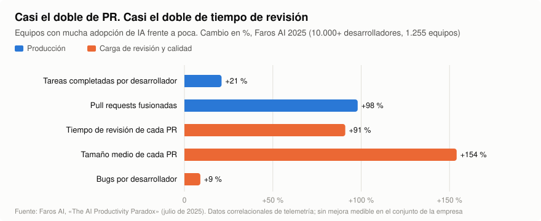
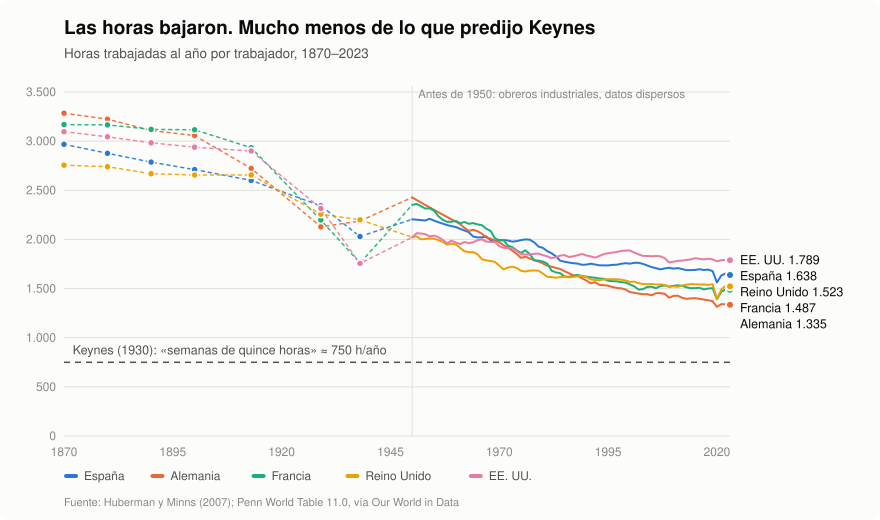
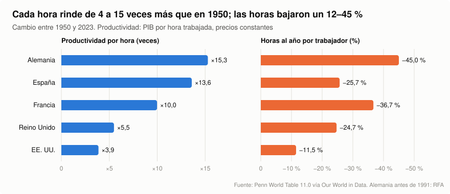
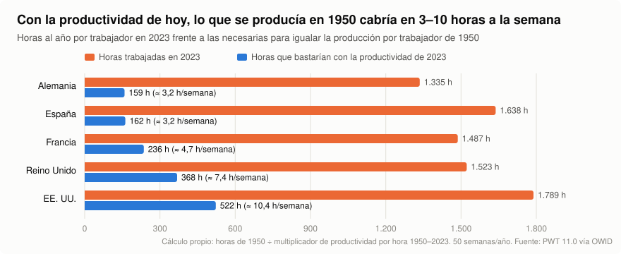
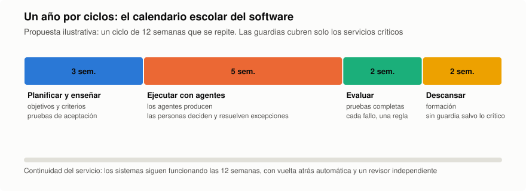

# Programadores con vacaciones de profesor

*Por qué la inteligencia artificial nos obliga a decidir quién se queda con el tiempo que ahorra.*

**Raul Illana** · Octubre de 2026 · Lectura: 18 minutos

---

> **En corto**
>
> - Con agentes de IA, el programador pasa de escribir código a enseñar, encargar y corregir. Se parece más a un profesor que a un operario.
> - Los agentes producen más, pero el trabajo humano se desplaza a la revisión: en equipos con mucha IA se fusionan casi el doble de *pull requests* (PR) y revisar cada una lleva casi el doble de tiempo.
> - Ya ha pasado antes. Desde 1950, cada hora de trabajo rinde entre 4 y 15 veces más en cinco grandes economías, y aun así seguimos trabajando entre 1.300 y 1.800 horas al año. Keynes imaginó semanas de quince horas; nos quedamos en casi cuarenta.
> - Repartir el tiempo ganado es posible: en las pruebas de semana de cuatro días, la mayoría de las empresas quiso seguir. Pero no ocurre solo. Si nadie lo decide, la IA se traducirá en más trabajo, no en más vida.
> - La propuesta: organizar el trabajo con agentes por ciclos, como el curso escolar, con periodos protegidos de descanso que solo son posibles si la verificación del trabajo deja de depender de una persona despierta.

---

## 0. Una reivindicación que empezó como un chiste

Todo empezó con una frase medio en broma: *si tenemos que criar a una generación de agentes artificiales, que nos den también las vacaciones de verano*.

La broma funciona porque tiene algo de verdad. Quienes trabajamos con agentes de IA dedicamos cada vez menos tiempo a escribir código y cada vez más a preparar contexto, poner tareas, corregir resultados y enseñar criterio. Es decir, a hacer de profesores. Y, sin embargo, seguimos midiendo nuestro trabajo como si cada línea la tecleáramos nosotros.

Este texto se toma la broma en serio. No pide literalmente tres meses de vacaciones para cada programador: los tres meses son un lema. Pide algo más difícil de conseguir: que alguien decida a dónde va el tiempo que las máquinas liberan, en lugar de dejar que se lo trague, por defecto, más trabajo.

## 1. El programador ya no programa: enseña

Un agente de IA no llega sabiendo. Puede tener conocimientos generales extraordinarios y suspender la asignatura concreta: la arquitectura de tu sistema, las convenciones de tu equipo, los límites de seguridad, los errores que no debe repetir. Igual que un alumno brillante que no ha venido a clase.

El trabajo diario de quien dirige agentes se parece cada vez más al de un docente:

| En el aula | Con agentes de IA |
|---|---|
| Preparar el temario | Dar contexto: arquitectura, documentación, convenciones y límites |
| Poner ejercicios | Partir un problema en tareas que se puedan comprobar |
| Corregir exámenes | Revisar código, ejecutar pruebas, detectar los errores que el agente no ve |
| Enseñar criterio | Decidir cuándo una solución que funciona es, aun así, insegura o imposible de mantener |
| Coordinar el aula | Repartir el trabajo entre varios agentes para que sus partes encajen |
| Actualizar el temario | Rehacer instrucciones y herramientas al ritmo al que cambia la tecnología |

La diferencia fundamental es que este alumno no duerme. Puede trabajar de madrugada y entregar decenas de tareas a la vez. Y ahí empieza el problema.

## 2. El alumno que nunca duerme

Si los alumnos pudieran estudiar las veinticuatro horas del día y entregar cien trabajos a la vez, nadie concluiría que sus profesores deben estar disponibles las veinticuatro horas para corregirlos. Que se puedan generar mil respuestas no significa que alguien pueda evaluarlas bien en cinco minutos.

En el desarrollo de software estamos normalizando justo eso. Los datos recientes no se ponen de acuerdo en cuánto ahorra la IA, pero coinciden en dos cosas: medimos mal y revisamos más.

### 2.1. Cuánto tiempo ahorra la IA: menos de lo que creemos

| Estudio | Muestra | Resultado | Salvedades |
|---|---|---|---|
| Cui, Demirer y otros, *Management Science* (2025) | 3 experimentos de campo, 4.867 desarrolladores (Microsoft, Accenture y otra gran empresa) | **+26 %** de tareas completadas | Asistentes de autocompletado de 2022-2023, no agentes |
| Google, Paradis y otros (2024) | 96 ingenieros, una tarea compleja | **−21 %** de tiempo | Una sola tarea de laboratorio; intervalo de confianza amplio |
| METR (2025) | 16 desarrolladores veteranos, 246 tareas reales de sus propios proyectos | **+19 % de tiempo**: fueron más lentos. Esperaban ir un 24 % más rápido y, al acabar, creían haber ido un 20 % más rápido | Muestra pequeña; herramientas de principios de 2025 |
| METR (2026), repetición | 57 desarrolladores, más de 800 tareas | **−18 %** de tiempo en los desarrolladores del estudio original y **−4 %** en los nuevos, pero ningún intervalo excluye el cero | Los propios autores lo consideran ya un mal medidor: muchos se negaron a trabajar sin IA |
| Anthropic (2026) | 52 ingenieros, en su mayoría júnior, aprendiendo una librería | Sin aceleración significativa; **50 %** de acierto en comprensión frente a **67 %** sin IA | Tarea de aprendizaje; lo financia una empresa de IA |

Dos conclusiones. La primera: el efecto real va de más lento a bastante más rápido según la herramienta, la tarea y la persona. La segunda es más incómoda: **medimos muy mal cuánto nos ahorra la IA**. Los veteranos de METR iban un 19 % más lentos y estaban convencidos de ir un 20 % más rápido.

### 2.2. Dónde va el tiempo que sí se ahorra

Cuando la IA ahorra tiempo, ¿adónde va? Los datos de telemetría apuntan a un sitio: a revisar.

<picture>
  <source media="(prefers-color-scheme: dark)" srcset="img/fig4-paradoja-productividad-dark.svg">
  
</picture>

*Figura 1. La paradoja de la productividad. Fuente: Faros AI (2025), telemetría de más de 10.000 desarrolladores y 1.255 equipos.*

Faros AI llama a esto «la paradoja de la productividad»: los equipos que más usan la IA fusionan casi el doble de PR, aunque las tareas completadas solo suben un 21 %, y cada PR es más grande y tarda casi el doble en revisarse. En el conjunto de la empresa, la mejora no aparece. (Es un estudio correlacional, hecho por una empresa que vende herramientas de medición.) Otros datos apuntan en la misma dirección:

| Fuente | Dato |
|---|---|
| Stack Overflow, encuesta 2025 (49.000 respuestas) | El **84 %** usa o va a usar IA. El **45,7 %** desconfía de su precisión, frente a un **32,7 %** que confía. La mayor frustración, para el **66 %**: soluciones que «casi» están bien |
| DORA, informe 2025 (unos 5.000 profesionales) | El **90 %** usa IA, con una mediana de 2 horas al día. La IA ya mejora el ritmo de entrega, pero sigue asociada a **menos estabilidad** |
| GitClear (2025, 211 millones de líneas) | El código copiado y pegado sube del **8,3 %** al **12,3 %** entre 2021 y 2024, y el código movido (indicio de refactorización) baja del **25 %** a **menos del 10 %**. Correlacional; GitClear vende herramientas de calidad |
| Atlassian, *State of DevEx* 2025 (3.500 personas) | El **68 %** ahorra más de 10 horas a la semana con IA. El **50 %** pierde 10 horas o más en fricciones organizativas. Programar ocupa solo el **16 %** de su tiempo |

El dato de Atlassian resume el problema mejor que ninguno: se ganan diez horas y se pierden diez horas. La IA abarata producir código, pero comprobar que es correcto no se ha abaratado al mismo ritmo. Y alguien tiene que hacerlo.

Si una organización convierte cada hora que ganan las máquinas en más entregas, el beneficio de la tecnología se transforma en una obligación. La productividad artificial no puede convertirse en una condena humana a la disponibilidad permanente.

## 3. La pregunta que Keynes ya hizo en 1930

Esto ya ha pasado antes. En 1930, John Maynard Keynes escribió *Las posibilidades económicas de nuestros nietos*. Predijo que en cien años el nivel de vida de los países avanzados sería «entre cuatro y ocho veces» mayor, e imaginó que la generación de nuestros nietos podría repartirse el trabajo que quedara en «turnos de tres horas o semanas de quince horas».

Acertó en lo primero y falló en lo segundo.

<picture>
  <source media="(prefers-color-scheme: dark)" srcset="img/fig1-horas-1870-2023-dark.svg">
  
</picture>

*Figura 2. Horas trabajadas al año por trabajador. Fuentes: Huberman y Minns (2007); Penn World Table 11.0, vía Our World in Data.*

Las horas bajaron, pero mucho menos de lo que subió la productividad; en Estados Unidos apenas se han movido desde 1980. Mientras tanto, cada hora de trabajo se volvió muchísimo más productiva:

<picture>
  <source media="(prefers-color-scheme: dark)" srcset="img/fig2-productividad-vs-horas-dark.svg">
  
</picture>

*Figura 3. Productividad por hora y horas trabajadas, 1950–2023. Fuente: Penn World Table 11.0, vía Our World in Data.*

En España, cada hora de trabajo produce hoy 13,6 veces más que en 1950, y trabajamos solo un 25,7 % menos. Dicho de otra forma:

<picture>
  <source media="(prefers-color-scheme: dark)" srcset="img/fig3-horas-necesarias-dark.svg">
  
</picture>

*Figura 4. Horas reales frente a horas suficientes para producir lo de 1950. Cálculo propio a partir de Penn World Table 11.0.*

Con la productividad actual, un trabajador español produciría lo mismo que en 1950 en unas 162 horas al año: poco más de tres horas a la semana. Keynes no se equivocó en la aritmética. Se equivocó en lo que haríamos con ella.

La explicación tiene más de siglo y medio. En 1865, William Stanley Jevons sostuvo que las máquinas de vapor más eficientes no harían que Inglaterra gastara menos carbón, sino más: al abaratarse, se usaría para más cosas. Con el software ya está pasando. Desde la llegada de los agentes de programación a principios de 2025, las ofertas de empleo de desarrollo de software en Estados Unidos han subido en torno a un 15 %, mientras el total de ofertas caía un 7 % (Indeed Hiring Lab, 2026). Pero el 71 % de ese aumento son puestos sénior, y el empleo de los trabajadores de 22 a 25 años en las ocupaciones más expuestas a la IA, entre ellas la programación, está un 19 % por debajo de lo esperable (Stanford Digital Economy Lab, 2026). Es un Jevons sesgado: más demanda para quien supervisa, menos para quien aprende.

Por eso la pregunta importante no es si la IA permite trabajar menos. Es esta: **cuando una máquina hace en diez minutos lo que antes costaba dos horas, ¿quién se queda con la hora y cincuenta minutos?**

| Quién se queda el tiempo | Cómo se ve | Qué pasa por defecto |
|---|---|---|
| La empresa | Más entregas, más proyectos, menos contratación | Es lo más fácil de medir y lo que ocurre si nadie decide nada |
| La calidad | Más revisión, más pruebas, menos errores en producción | Ocurre a medias, y casi siempre a costa de horas de las personas |
| La persona | Jornadas más cortas, semanas de cuatro días, periodos de descanso | Solo ocurre si se negocia o se legisla |

La tecnología no elige entre estas opciones. Eligen las organizaciones y las leyes.

## 4. Lo que ya sabemos sobre repartir el tiempo

Reducir la jornada sin perder resultados se ha probado, y con datos:

| Prueba | Participantes | Resultado |
|---|---|---|
| Reino Unido, 2022 (6 meses) | 61 empresas, unas 2.900 personas | **56** decidieron seguir; un año después, al menos **54** la mantenían y **31** ya de forma permanente. Ingresos estables (+1,4 %). El **71 %** declaró menos *burnout*. Horas semanales de 38 a 34 |
| Estados Unidos e Irlanda, 2022 (6 meses) | 33 empresas, 903 personas | Ingresos +8,1 %. Horas semanales de 40,8 a 34,8. Ninguna de las 27 que respondieron pensaba volver atrás |
| Portugal, 2023 (6 meses) | 41 empresas | Horas semanales de 39,3 a 34. Agotamiento −19 %. El 93 % de los trabajadores quería seguir |
| Alemania, 2024 (6 meses) | 45 organizaciones | Más del 70 % quiso seguir o implantarla del todo. Sin cambios significativos en beneficios ni bajas |

*Las empresas participaron voluntariamente, así que no son una muestra representativa. Las cifras son declaradas por las propias empresas y participantes; en el caso británico, la bajada de bajas por enfermedad (−65 %) y de abandonos (−57 %) no es estadísticamente significativa. Los datos de Portugal y Alemania proceden de informes recogidos en prensa.*

Ninguna de estas empresas trabajaba con agentes de IA. Si redistribuir el tiempo ya era posible sin ellos, con ellos hay más margen que repartir. Que se reparta depende, otra vez, de quién lo decida.

En España, la jornada legal sigue siendo, a octubre de 2026, de 40 horas semanales, como desde 1983. El proyecto para reducirla a 37,5 horas fue devuelto al Gobierno por el Congreso el 10 de septiembre de 2025 (178 votos a favor de la devolución, 170 en contra). En la práctica, quien trabaja a tiempo completo en España hace de media 38,7 horas efectivas a la semana, igual que la media de la Unión Europea (Eurostat, 2025).

## 5. Por qué el profesor (y dónde falla la comparación)

Un modelo de IA no es un niño. La mayoría de los programadores ni siquiera lo entrena: configura un sistema ya entrenado con instrucciones, contexto, herramientas y pruebas. Decir que educamos agentes igual que los profesores educan niños sería falso.

Tampoco es verdad que los profesores tengan tres meses de vacaciones:

| Profesorado de ESO, centros públicos | España | Media OCDE |
|---|---|---|
| Días lectivos al año | 176 | 184 |
| Horas de clase al año | 642 | 710 |
| Jornada anual total | 1.385 h | 1.579 h |

*Fuente: OCDE, Education at a Glance (periodo de referencia 2025). La ley española fija un mínimo de 175 días lectivos.*

Sus vacaciones son agosto. Julio no tiene clases, pero en la mayoría de las comunidades sigue siendo laborable: cierre del curso, memorias, formación, tribunales y preparación del siguiente.

¿Por qué tres meses, entonces? No porque exista una equivalencia científica entre el verano de un profesor y las líneas de código que genera un agente. Tres meses es lo que cualquiera imagina cuando piensa en el calendario escolar, y por eso funciona como lema.

Pero justo ahí está lo útil de la comparación. El trabajo docente se organiza en ciclos: periodos intensos con el aula llena y periodos para preparar, evaluar y recuperarse. Lo que la comparación cuestiona es una costumbre de nuestro sector: creer que la presencia continua de una persona equivale a productividad.

## 6. El puente que falta: solo se descansa si la verificación no depende de ti

Esta propuesta tiene un punto débil, y conviene mirarlo de frente. Si el cuello de botella es la revisión humana, más agentes significan más trabajo, no menos. Para que el programador pueda irse, el sistema tiene que poder seguir sin él. Eso se construye:

- **Pruebas que deciden solas** si algo está bien, en lugar de una persona leyéndolo todo.
- **Un revisor distinto del que construye.** El agente que hace el trabajo no puede ser el que lo da por bueno.
- **Pasos que se pueden deshacer.** Cada cambio con su copia previa y su vuelta atrás automática si algo deja de responder.
- **Límites y frenos:** qué puede tocar cada agente, cuánto puede gastar y quién lo para.
- **Guardias para lo que de verdad importa,** y nadie de guardia para lo que no.

Ese andamiaje cuesta, y mucho: escribir las pruebas, las reglas y los revisores también es trabajo humano. Es, precisamente, el julio del profesor. La diferencia es que buena parte se reutiliza de un ciclo a otro.

Con todo eso se puede separar algo que solemos mezclar: la continuidad del servicio y la continuidad de la persona. Un sistema puede funcionar permanentemente sin exigir que la misma persona permanezca permanentemente trabajando. Los hospitales y los aeropuertos llevan décadas haciéndolo con turnos. Lo nuevo es que parte de esos turnos los puede cubrir software, siempre que sepamos comprobar lo que hace.

## 7. Lo que he aprendido en Acrònims

Esto lo escribo desde dentro. En Acrònims, un pequeño grupo de proyectos que estoy montando, buena parte del trabajo técnico lo hacen agentes de IA coordinados por un agente central que me rinde cuentas.

Mucho de ese trabajo ocurre de madrugada: actualizaciones, cambios de configuración, revisiones. Desde este otoño, la regla es que cada tanda lleve su copia de seguridad y su vuelta atrás automática, y que después un agente distinto del que hizo el cambio compruebe que todo responde igual que antes. Intentamos que nada cuente como hecho hasta que hay una prueba que alguien que no lo hizo pueda repetir. Por la mañana me llega un resumen corto con lo que se ha hecho y lo que necesita mi decisión.

Mi trabajo ha cambiado: escribo poco código. Decido qué hay que hacer, defino cómo sabremos que está bien hecho y apruebo lo que tiene riesgo.

No funciona sin errores. Hemos roto cosas nosotros mismos, y hemos tenido agentes que daban por terminado un trabajo que no lo estaba. Si tuviera que poner boletín de notas al agente central, diría: «Aplica bien las normas. A veces entrega los deberes sin hacerlos. Progresa adecuadamente». Cada fallo deja una regla nueva, y cada regla nueva reduce las noches en las que alguien tiene que estar despierto.

Conviene ser honesto sobre lo que esto demuestra. Aquí no hay una plantilla con la que repartir el tiempo ganado, así que no prueba la parte social de la tesis. Prueba la técnica: que el puente del apartado anterior se puede construir hoy, con herramientas que ya existen.

## 8. La propuesta: el calendario escolar del software

En lugar de exigir tres meses para todos, propongo que los equipos que trabajan intensivamente con agentes se organicen por ciclos, como un curso escolar:

<picture>
  <source media="(prefers-color-scheme: dark)" srcset="img/fig5-calendario-ciclos-dark.svg">
  
</picture>

*Figura 5. Un ciclo de 12 semanas que se repite. Las duraciones son ilustrativas.*

1. **Planificar y enseñar.** Objetivos, arquitectura, documentación y, sobre todo, los criterios con los que se comprobará cada entrega.
2. **Ejecutar con agentes.** Los agentes producen; las personas resuelven excepciones y toman las decisiones con riesgo.
3. **Evaluar y consolidar.** Pruebas completas, seguridad y rendimiento. Cada fallo se convierte en una instrucción o una regla mejor.
4. **Descansar y renovarse.** Periodos protegidos de descanso, formación e investigación, sin quedar disponibles solo porque las máquinas siguen trabajando.

La fase 4 exige condiciones verificables:

| Condición para desconectar | Cómo se comprueba |
|---|---|
| Las pruebas cubren lo que importa | Una persona ajena al equipo rompe algo a propósito y las pruebas lo detectan |
| Cada cambio se puede deshacer solo | Se ensaya una vuelta atrás en un entorno real |
| Hay un revisor independiente | Ningún cambio llega a producción aprobado por quien lo hizo |
| Las guardias cubren solo lo crítico | Hay una lista explícita de servicios críticos y de quién responde por ellos |
| Los agentes tienen límites | Presupuesto, permisos y un botón de parada documentados y probados |

No todos los ciclos durarán lo mismo, y no todos los servicios podrán quedarse sin supervisión: lo crítico necesitará guardias y redundancia. Pero cuando el modelo demuestre que mantiene la calidad y el servicio, tocará negociar cómo se reparte lo ganado: semana de cuatro días, jornadas más cortas, permisos más largos o, por qué no, veranos más largos.

Hecha la cuenta, el calendario por ciclos da unas nueve semanas de descanso al año. No son los tres meses del lema, pero es un buen comienzo para la negociación.

## 9. Objeciones

| Objeción | Respuesta |
|---|---|
| «La IA ni siquiera ahorra tiempo» | En algunos estudios, no. En otros, sí. METR cree que la aceleración real ya es mayor, aunque sus propios datos de 2026 no lo demuestran. La propuesta no depende de que la IA ahorre mucho: depende de que el tiempo que ahorre no se lo quede solo la empresa |
| «Por Jevons, se producirá más software, no menos trabajo» | Probablemente. Por eso el reparto tiene que decidirse explícitamente: si se deja al mercado, gana la opción de producir más |
| «Los profesores no tienen tres meses libres» | Cierto, y el texto lo dice. La comparación es por la organización en ciclos, no por las vacaciones |
| «Esto solo vale para empresas grandes» | Al contrario: una empresa pequeña con buena verificación automática puede desconectar antes que una grande que depende de que alguien lo lea todo |
| «Los júniores pierden» | Sí, y es el riesgo más serio. Si los agentes hacen el trabajo con el que se aprendía, la fase de enseñar tiene que incluir también a las personas, no solo a las máquinas |

## 10. Conclusión: que la IA también nos haga más libres

Estamos invirtiendo cantidades enormes en construir máquinas que trabajan más rápido y con más autonomía. Es razonable preguntar qué gana con ello la persona que tiene que diseñarlas, vigilarlas y responder cuando se equivocan.

Los datos de un siglo dicen que la productividad, por sí sola, no regala tiempo libre: sin una decisión explícita, se convierte en más producción. La IA no cambiará esa regla. Lo que sí cambia es la escala: nunca había sido tan fácil producir tanto con tan poco trabajo humano, y nunca había sido tan evidente que el tiempo ganado podría repartirse.

La verdadera revolución de la IA no será solo que las máquinas hagan parte del trabajo de las personas. Será que las personas dejen de estar obligadas a llenar con más trabajo todo el tiempo que las máquinas les ahorran.

Si para conseguirlo hay que empezar a llamar profesores a los programadores, alumnos a los agentes y verano a la desconexión, quizá la broma esté señalando algo más serio de lo que parece. Al fin y al cabo, si ya hemos creado máquinas que trabajan mientras dormimos, lo mínimo es empezar a hablar de cuándo nos toca dormir a nosotros.

Y, ya puestos, de cuándo nos toca el verano.

*Raul Illana, profesor de agentes que no conocen el concepto de vacaciones.*

---

## Fuentes

**IA y productividad del software**

1. Cui, Z. K., Demirer, M., Jaffe, S., Musolff, L., Peng, S. y Salz, T. «The Effects of Generative AI on High-Skilled Work: Evidence from Three Field Experiments with Software Developers». *Management Science*, 2025. https://pubsonline.informs.org/doi/10.1287/mnsc.2025.00535
2. Paradis, E. y otros. «How much does AI impact development speed? An enterprise-based randomized controlled trial». 2024. https://arxiv.org/abs/2410.12944
3. METR. «Measuring the Impact of Early-2025 AI on Experienced Open-Source Developer Productivity». Julio de 2025. https://metr.org/blog/2025-07-10-early-2025-ai-experienced-os-dev-study/
4. METR. Actualización del estudio. Febrero de 2026. https://metr.org/blog/2026-02-24-uplift-update/
5. Anthropic. «How AI assistance impacts the formation of coding skills». Enero de 2026. https://www.anthropic.com/research/AI-assistance-coding-skills
6. Faros AI. «The AI Productivity Paradox». Julio de 2025. https://www.faros.ai/blog/ai-software-engineering
7. Stack Overflow. *Developer Survey 2025*, sección de IA. https://survey.stackoverflow.co/2025/ai
8. DORA (Google Cloud). *State of AI-assisted Software Development 2025*. https://cloud.google.com/blog/products/ai-machine-learning/announcing-the-2025-dora-report
9. GitClear. *AI Copilot Code Quality 2025*. https://www.gitclear.com/ai_assistant_code_quality_2025_research
10. Atlassian. *State of Developer Experience 2025*. https://www.atlassian.com/blog/developer/developer-experience-report-2025

**Empleo**

11. Indeed Hiring Lab. «AI and Job Postings: From Destruction to Creation?». Julio de 2026. https://hiringlab.indeed.com/2026/07/08/ai-and-job-postings-from-destruction-to-creation/
12. Stanford Digital Economy Lab (Brynjolfsson, Chandar y Chen). «No Widespread Displacement, but the AI Employment Gap for Young Workers Has Widened to 19%». Agosto de 2026, actualización de «Canaries in the Coal Mine» (2025). https://digitaleconomy.stanford.edu/news/canariesaug26/

**Horas, productividad e historia**

13. Keynes, J. M. «Economic Possibilities for our Grandchildren» (1930), en *Essays in Persuasion*. https://www.econ.yale.edu/smith/econ116a/keynes1.pdf · contexto de la cita: https://quoteinvestigator.com/2025/02/03/work-week/
14. Jevons, W. S. *The Coal Question*. 1865.
15. Huberman, M. y Minns, C. «The times they are not changin': Days and hours of work in Old and New Worlds, 1870–2000». *Explorations in Economic History*, 2007. https://personal.lse.ac.uk/minns/Huberman_Minns_EEH_2007.pdf
16. Feenstra, R. C., Inklaar, R. y Timmer, M. P. *Penn World Table 11.0*, vía Our World in Data: https://ourworldindata.org/grapher/annual-working-hours-per-worker y https://ourworldindata.org/grapher/labor-productivity-per-hour-pennworldtable
17. Eurostat. Horas semanales efectivas en el empleo principal (lfsa_ewhan2), 2025. https://ec.europa.eu/eurostat/databrowser/view/lfsa_ewhan2/default/table

**Semana de cuatro días**

18. Autonomy y 4 Day Week Global. *The results are in: The UK's four-day week pilot*. 2023. https://autonomy.work/portfolio/uk4dwpilotresults/
19. Autonomy. *Making It Stick: The UK Four-Day Week Pilot One Year On*. 2024. https://autonomy.work/2024/02/21/make-it-stick/
20. 4 Day Week Global. Resultados de la prueba de Estados Unidos e Irlanda. 2023. https://www.4dayweek.com/us-ireland-results
21. Prueba de Portugal (IEFP, 2023-2024), según informes recogidos en prensa; prueba de Alemania (Universidad de Münster, 2024): https://idw-online.de/de/news841503

**España**

22. Congreso de los Diputados. Acta taquigráfica del Pleno, 10 de septiembre de 2025 (debate de totalidad del proyecto de ley de reducción de jornada, expediente 121/000058). https://www.congreso.es/docu/tramit/LegXV/AT/ATCD_15_PL_20250910.pdf
23. OCDE. *Education at a Glance*: tiempo de trabajo estatutario del profesorado. https://www.oecd.org/en/publications/education-at-a-glance-2026_c0e523a9-en.html
24. Ley Orgánica 2/2006 de Educación, disposición adicional quinta. https://www.boe.es/buscar/act.php?id=BOE-A-2006-7899

---

*Escrito con ayuda de herramientas de IA (ChatGPT y Claude). La búsqueda de datos y los gráficos los preparó un agente de IA, y yo los revisé. Las ideas, las decisiones y la firma son mías. Los datos y los gráficos se pueden reproducir con los ficheros de la carpeta [`datos/`](datos/).*
